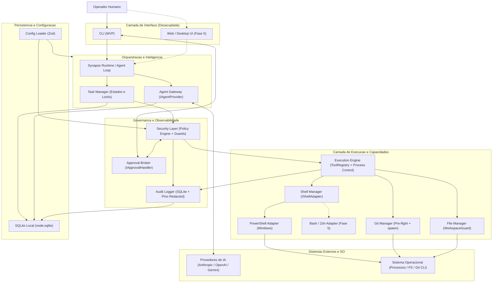
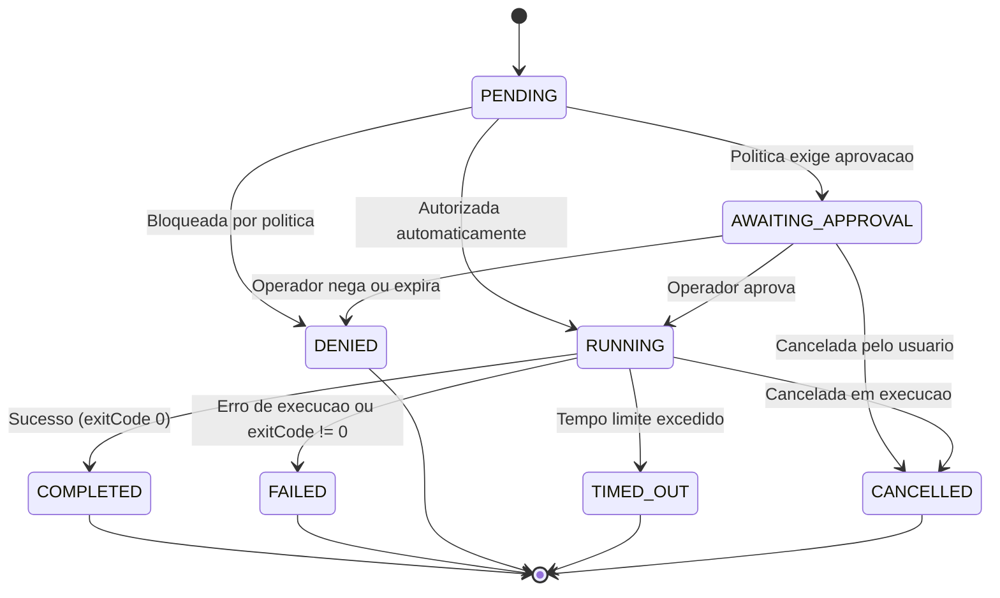

# 03 — Arquitetura Proposta

## 1. Visão Arquitetural Geral

O **SYNAPSE** adota uma **Arquitetura Modular em Camadas (Monólito Modular Local)** orientada a portas e adaptadores (*Ports & Adapters*).

### Por que Monólito Modular no MVP (em vez de Monorepo Multi-pacotes ou Microsserviços)?
- **Baixa complexidade acidental:** no MVP, todos os módulos rodam no mesmo processo Node.js local; introduzir monorepo complexo (`workspaces`, builds encadeados, versionamento interno) ou IPC prematuro adicionaria atrito sem ganho funcional real.
- **Fronteiras reais preservadas:** cada módulo vive em `src/modules/<modulo>/` com contratos explícitos (`types.ts` / `interfaces.ts`) e importação restrita à sua superfície pública (`index.ts`). Se na Fase 5 surgir a necessidade de extrair `packages/core`, `packages/cli` e `packages/ui`, a migração será direta.
- **Desacoplamento da interface:** a CLI (`src/cli/`) nunca acessa diretamente shell, sistema de arquivos, Git ou SQLite — ela interage apenas com a fachada de aplicação (`SynapseRuntime` / Application Services) e recebe eventos estruturados.

### Camadas Lógicas

1. **Interface Layer (`cli/` e futuras UIs/APIs):** entrada de comandos do usuário, renderização de progresso, coleta de aprovação humana e exibição de logs/histórico.
2. **Orchestration & Intelligence Layer (`agent-gateway`, `task-manager`, `runtime`):** comunicação com provedores de IA, gerenciamento de sessões, ciclo de *tool calling*, controle de estados e coordenação de concorrência.
3. **Governance & Observability Layer (`security`, `audit`):** interceptação obrigatória de toda operação (*Policy Enforcement Point*), validação de schema, avaliação de política, mediação de aprovação humana, proteção de credenciais e auditoria imutável.
4. **Execution & Capabilities Layer (`execution-engine`, `shell-manager`, `file-manager`, `git-manager`, `tools`):** execução controlada de ferramentas, gerenciamento de processos/timeouts e isolamento de especificidades do sistema operacional.
5. **Persistence & Configuration Layer (`storage`, `config`):** SQLite local (sessões, tarefas, aprovações, trilha de auditoria) e carregamento/validação de configurações.

---

## 2. Diagrama de Componentes



---

## 3. Responsabilidades e Contratos dos Módulos

### 3.1 Agent Gateway (`src/modules/agent-gateway`)
- **Responsabilidades:**
  - Registrar e instanciar provedores via interface `IAgentProvider`.
  - Traduzir mensagens internas (`SynapseMessage`), definições de ferramentas (`ToolDefinition`) e resultados (`ToolResult`) para o formato nativo de cada SDK.
  - Gerenciar sessões (histórico, resumo de contexto, metadados do modelo, contagem de tokens quando retornada pela API).
  - Aplicar políticas de timeout, retry com backoff exponencial para erros transitórios (HTTP 429/5xx) e normalização de erros.
- **Fronteira:** não executa ferramentas, não acessa disco do workspace e não decide permissões.

### 3.2 Task Manager (`src/modules/task-manager`)
- **Responsabilidades:**
  - Criar tarefas a partir de cada intenção de execução ou chamada de ferramenta do agente.
  - Controlar transições válidas da máquina de estados da tarefa.
  - Gerenciar fila e bloqueios (*locks*) por workspace/recurso: operações de leitura podem ser isoladas ou sequenciadas com baixo atrito; operações de mutação (escrita de arquivo, operações Git mutáveis, comandos shell) são serializadas no mesmo workspace para evitar *race conditions* e corrupção de `.git/index.lock`.
  - Propagar `AbortController`/`AbortSignal` para cancelamento determinístico.

#### Máquina de Estados da Tarefa



### 3.3 Security Layer (`src/modules/security`)
- **Responsabilidades:**
  - Interceptar **100%** das operações antes que cheguem ao `Execution Engine` (ponto único de aplicação de política — *Policy Enforcement Point*).
  - Validar payload contra schema Zod da ferramenta.
  - Resolver e canonizar caminhos (`path.resolve` + `fs.realpath` quando o alvo existe, ou do diretório pai quando o arquivo ainda será criado) para impedir escape do workspace via `..`, caminhos absolutos ou *symlinks*/*junctions* do Windows.
  - Analisar argumentos e efeitos colaterais (não depender apenas de listas de comandos proibidos).
  - Classificar a operação (`AUTO`, `CONDITIONAL`, `HUMAN_APPROVAL`, `DENIED`) e acionar o `Approval Broker` quando necessário.
  - Sanitizar variáveis de ambiente passadas a subprocessos (*env allowlist/scrubbing*) para impedir vazamento de API keys e tokens.

### 3.4 Execution Engine (`src/modules/execution-engine`)
- **Responsabilidades:**
  - Manter o registro de ferramentas disponíveis (`ToolRegistry`) com seus schemas Zod, metadados de risco e executores.
  - Aceitar apenas objetos `AuthorizedOperation` emitidos após aprovação da `Security Layer`.
  - Gerenciar ciclo de vida de processos filhos: timeout rígido, cancelamento via `AbortSignal`, encerramento de árvore de processos no Windows (evitando processos órfãos), captura de `stdout` e `stderr` com teto configurável de bytes e marcação de truncamento.
  - Retornar sempre um `ExecutionResult` padronizado e estruturado.

### 3.5 Shell Manager (`src/modules/shell-manager`)
- **Responsabilidades:**
  - Prover a interface `IShellAdapter` (`id`, `detect()`, `buildInvocation(command, options)`, `normalizeExitCode()`).
  - Implementar `PowerShellAdapter` no Windows:
    - Priorizar PowerShell 7+ (`pwsh.exe`), com suporte explícito e configurável a Windows PowerShell 5.1 (`powershell.exe`) como fallback controlado.
    - Invocar com `-NoProfile -NonInteractive -ExecutionPolicy Bypass` (ou política configurada) e encoding UTF-8 consistente (`[Console]::OutputEncoding = [System.Text.Encoding]::UTF8`), evitando contaminação por perfis do usuário e corrupção de acentuação/JSON.
    - Tratar erros não terminantes vs terminantes do PowerShell (`$ErrorActionPreference` e `$LASTEXITCODE`) para refletir falhas reais no código de saída.
  - Preparar terreno limpo para `BashAdapter` e `ZshAdapter` na Fase 5 sem tocar no `Execution Engine`.

### 3.6 Git Manager (`src/modules/git-manager`)
- **Responsabilidades:**
  - Expor operações estruturadas: `init`, `clone`, `status`, `diff`, `log`, `branch`, `checkout`, `add`, `commit`, `pull`, `push`, `merge`, `tag`.
  - Invocar o binário `git` diretamente via `spawn` com **`shell: false`** e array de argumentos explicitamente validados (eliminando injeção de comandos via shell).
  - Aplicar *pre-flight checks* antes de operações mutáveis ou de rede:
    - Confirmar que o diretório pertence ao workspace e é repositório Git válido (exceto `init`/`clone`).
    - Inspecionar branch atual, estado *detached HEAD*, working tree sujo e conflitos pendentes.
    - Rejeitar argumentos proibidos por padrão (`--force`, `-f`, `--force-with-lease` sem regra explícita, `--hard`, `-D` sem autorização, hooks arbitrários via `-c core.hooksPath=...`).
    - Desabilitar prompts interativos de credenciais (`GIT_TERMINAL_PROMPT=0`) para nunca travar subprocessos indefinidamente.

### 3.7 File Manager (`src/modules/file-manager`)
- **Responsabilidades:**
  - Operações tipadas: `listDirectory`, `readFile`, `createFile`, `editFile`, `searchContent`, `moveFile`, `deleteFile`.
  - Usar `WorkspaceGuard` em toda operação de caminho.
  - Impedir leitura de arquivos binários grandes ou acima do limite de tamanho configurável sem sinalização explícita.
  - Bloquear por padrão leitura/escrita em arquivos sensíveis conhecidos (`.env`, `.env.*`, chaves privadas `*.pem`, `*.key`, `~/.ssh`, credenciais do sistema) salvo política explícita.
  - Preferir escrita segura (validação de diretório pai, preservação ou normalização previsível de encoding UTF-8).

### 3.8 Audit Logger (`src/modules/audit`)
- **Responsabilidades:**
  - Persistir eventos de auditoria estruturados em SQLite (tabela `audit_events` em modo *append-only*):
    - `eventId`, `timestamp`, `sessionId`, `taskId`, `agentId`/`provider`, `operationType`, `toolName`, `sanitizedInput`, `workingDirectory`, `policyDecision`, `approvalStatus`, `approvedBy`, `exitCode`, `durationMs`, `status`, `errorSummary`.
  - Emitir logs técnicos estruturados via **Pino** para diagnóstico operacional.
  - Executar pipeline centralizado de **redaction** (chaves conhecidas como `authorization`, `apiKey`, `token`, `password`, `secret` + padrões regex de tokens comuns como `sk-...`, `ghp_...`, `AIza...`, `Bearer ...`) antes de qualquer persistência ou escrita em log.

---

## 4. Fluxo de Comunicação Entre Agente e Executor

O diagrama abaixo descreve o ciclo completo desde o pedido do usuário até o retorno do resultado ao agente e a conclusão da tarefa.

```mermaid
sequenceDiagram
    actor User as Operador Humano
    participant CLI as CLI
    participant Loop as Agent Loop (Runtime)
    participant GW as Agent Gateway
    participant LLM as Provedor de IA
    participant TM as Task Manager
    participant SEC as Security Layer
    participant APP as Approval Broker
    participant ENG as Execution Engine
    participant TOOL as Executor (Shell / File / Git)
    participant AUD as Audit Logger

    User->>CLI: Envia objetivo / comando
    CLI->>Loop: Inicia turno na sessao
    Loop->>GW: Envia historico + definicoes de ferramentas
    GW->>LLM: Requisicao normalizada (API)
    LLM-->>GW: Resposta com ToolCall(s)
    GW-->>Loop: ToolCall normalizado

    Loop->>TM: Cria tarefa (status: PENDING)
    TM->>TM: Adquire lock do workspace (se mutavel)
    TM->>SEC: Solicita avaliacao de permissao e validacao Zod

    alt Operacao bloqueada por padrao
        SEC->>AUD: Registra DENIED
        SEC-->>TM: PolicyDecision = DENIED
        TM-->>Loop: Resultado de recusa estruturado
    else Operacao exige aprovacao (Condicional ou Humana)
        SEC->>TM: Atualiza status -> AWAITING_APPROVAL
        SEC->>APP: Solicita aprovacao (resumo + impacto + cwd)
        APP->>CLI: Exibe prompt de autorizacao
        CLI->>User: Aprovar operacao? [S/N]
        User-->>CLI: Decisao (Aprovado / Negado)
        CLI-->>APP: Resposta humana
        APP-->>SEC: ApprovalResult
    end

    alt Autorizada (AUTO ou aprovada pelo operador)
        SEC->>AUD: Registra decisao de autorizacao
        SEC-->>TM: AuthorizedOperation
        TM->>TM: Atualiza status -> RUNNING
        TM->>ENG: Executa operacao com timeout e AbortSignal
        ENG->>TOOL: Despacha para Shell / File / Git
        TOOL-->>ENG: stdout, stderr, exitCode, dados estruturados
        ENG->>AUD: Registra resultado sanitizado + duracao + exitCode
        ENG-->>TM: ExecutionResult
        TM->>TM: Libera lock + atualiza status (COMPLETED / FAILED / TIMED_OUT)
        TM-->>Loop: Resultado estruturado da ferramenta
    else Negada pelo operador
        SEC->>AUD: Registra DENIED (negada pelo humano)
        SEC-->>TM: PolicyDecision = DENIED
        TM-->>Loop: Resultado informando recusa humana
    end

    Loop->>GW: Envia ToolResult (sanitizado e truncado) ao modelo
    GW->>LLM: Continua turno com resultado real
    LLM-->>GW: Nova ToolCall OU resposta final
    GW-->>Loop: Resposta final
    Loop-->>CLI: Exibe conclusao ao operador
```

### Regras Invariantes do Fluxo
1. **Nenhum atalho:** o `Agent Gateway` jamais chama `Execution Engine`, `Shell Manager`, `File Manager` ou `Git Manager` diretamente.
2. **Controle de iterações (*Max Steps*):** o `Agent Loop` possui limite máximo configurável de rodadas de *tool calling* por turno para evitar loops infinitos e consumo descontrolado de créditos de API.
3. **Recusa informada:** quando uma operação é negada pela política ou pelo operador, o agente recebe um `ToolResult` explícito de negação (`status: "denied"`, motivo sanitizado) para poder propor alternativa segura em vez de tentar contornar silenciosamente.
4. **Falha determinística:** erros de execução são devolvidos com `exitCode` e `stderr` real (truncado e sanitizado); o SYNAPSE nunca mascara falhas como sucesso.

---

## 5. Estrutura de Diretórios Proposta

A estrutura abaixo organiza o repositório para suportar evolução incremental (Fases 1 a 5) sem dispersar responsabilidades:

```text
synapse/
├── README.md
├── docs/                                # Documentacao arquitetural, ADRs e guias
│   ├── 01-visao-produto.md
│   ├── 02-requisitos.md
│   ├── 03-arquitetura.md
│   ├── 04-stack-tecnologica.md
│   ├── 05-seguranca-permissoes.md
│   ├── 06-riscos-limitacoes.md
│   ├── 07-roadmap-mvp.md
│   ├── 08-decisoes-pendentes.md
│   └── adr/                             # Architecture Decision Records futuros
├── src/                                 # Codigo-fonte (a partir da Fase 1)
│   ├── index.ts                         # Composicao / exports publicos do nucleo
│   ├── cli/                             # Camada de interface CLI (desacoplada)
│   │   ├── main.ts                      # Entrypoint binario da CLI
│   │   ├── commands/                    # Subcomandos (run, exec, audit, config, status)
│   │   └── prompts/                     # Implementacao CLI do IApprovalHandler
│   ├── core/                            # Tipos compartilhados, erros tipados e runtime
│   │   ├── errors.ts                    # Hierarquia de erros (SynapseError, PolicyError, etc.)
│   │   ├── events.ts                    # Event bus tipado para observabilidade/UI futura
│   │   ├── runtime.ts                   # Orquestrador central (composicao dos modulos)
│   │   └── types.ts                     # Contratos comuns (ToolDefinition, ExecutionResult)
│   ├── config/                          # Carregamento, defaults e schemas Zod de config
│   │   ├── schema.ts
│   │   └── loader.ts
│   ├── storage/                         # Persistencia SQLite (node:sqlite) e migrations
│   │   ├── database.ts                  # Conexao e executor de migrations SQL
│   │   ├── migrations/                  # Scripts SQL versionados
│   │   └── repositories/                # Repositorios (sessions, tasks, audit)
│   └── modules/
│       ├── agent-gateway/               # Comunicacao com provedores de IA
│       │   ├── index.ts
│       │   ├── types.ts                 # IAgentProvider, SynapseMessage, ToolCall
│       │   ├── gateway.ts               # Gerenciador de provedores e sessoes
│       │   ├── agent-loop.ts            # Ciclo de tool calling com limite de passos
│       │   └── providers/               # Adaptadores concretos (Fase 3 / Fase 5)
│       ├── execution-engine/            # Despacho, timeout, processos e registry
│       │   ├── index.ts
│       │   ├── types.ts
│       │   ├── engine.ts
│       │   ├── tool-registry.ts
│       │   └── process-runner.ts        # Controle de processos e kill tree multiplataforma
│       ├── shell-manager/               # Adaptadores de shell isolados
│       │   ├── index.ts
│       │   ├── types.ts                 # IShellAdapter
│       │   ├── manager.ts
│       │   └── adapters/
│       │       └── powershell.adapter.ts # Prioridade Windows (Fase 1)
│       ├── file-manager/                # Operacoes controladas de arquivos (Fase 2)
│       │   ├── index.ts
│       │   ├── workspace-guard.ts       # Resolucao canonica e confinamento ao workspace
│       │   ├── manager.ts
│       │   └── tools.ts                 # Definicoes de tools expostas ao agente
│       ├── git-manager/                 # Operacoes Git com pre-flight checks (Fase 2)
│       │   ├── index.ts
│       │   ├── preflight.ts
│       │   ├── manager.ts
│       │   └── tools.ts
│       ├── security/                    # Politicas, validacao, aprovacoes e credenciais
│       │   ├── index.ts
│       │   ├── types.ts                 # IPolicyEngine, IApprovalHandler, PolicyDecision
│       │   ├── policy-engine.ts
│       │   ├── command-analyzer.ts      # Analise estruturada de argumentos e efeitos
│       │   ├── env-sanitizer.ts         # Scrubbing de variaveis sensiveis
│       │   └── redactor.ts              # Redaction centralizada de segredos
│       ├── task-manager/                # Ciclo de vida, estados e locks de concorrencia
│       │   ├── index.ts
│       │   ├── state-machine.ts
│       │   ├── workspace-lock.ts
│       │   └── manager.ts
│       └── audit/                       # Trilha de auditoria e logs estruturados
│           ├── index.ts
│           ├── logger.ts                # Configuracao Pino com redaction
│           └── audit-service.ts         # Gravacao e consulta de eventos no SQLite
├── tests/                               # Testes automatizados (Vitest)
│   ├── unit/                            # Testes isolados por modulo (espelhando src/)
│   ├── integration/                     # Testes com PowerShell/FS/Git em temp dirs
│   └── security/                        # Testes adversariais (traversal, injecao, leaks)
├── package.json                         # A ser criado na Fase 1
├── tsconfig.json                        # A ser criado na Fase 1
└── vitest.config.ts                     # A ser criado na Fase 1
```

### Convenções Estruturais
- **Sem dependências circulares:** o grafo de dependências entre módulos deve ser estritamente acíclico (`cli` -> `core/runtime` -> `modules/*` -> `storage`/`config`).
- **Artefatos de runtime fora do Git:** bancos SQLite locais (ex.: `.synapse/synapse.db`), logs locais e arquivos `.env` serão ignorados no `.gitignore` (a ser criado na Fase 1) para impedir commit acidental de dados sensíveis ou estado local.
